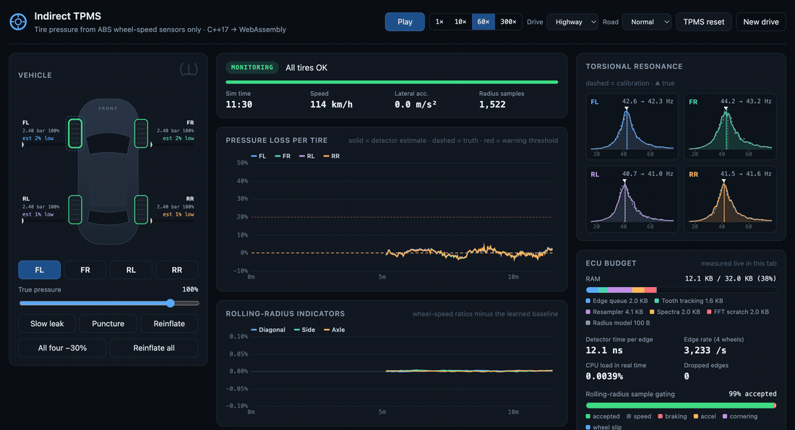
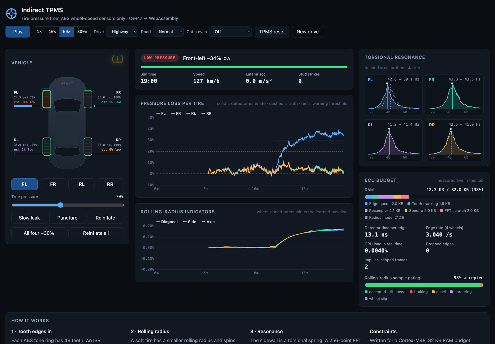
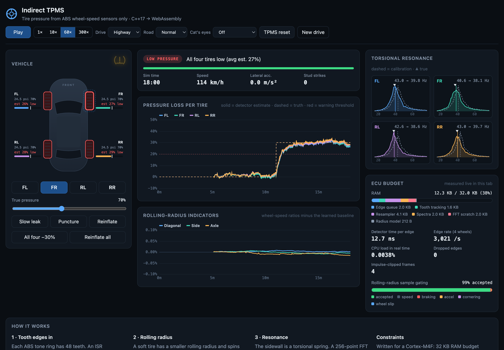
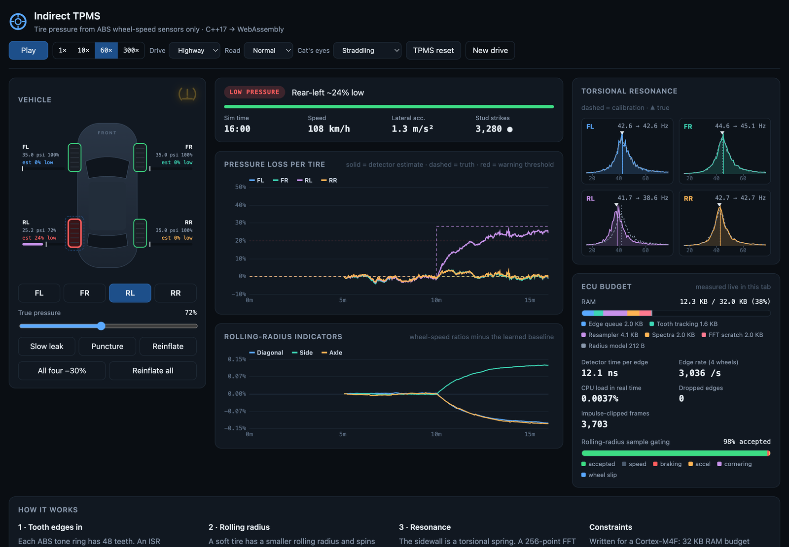
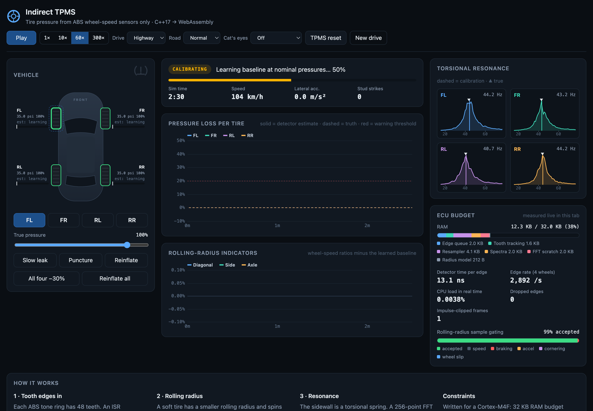
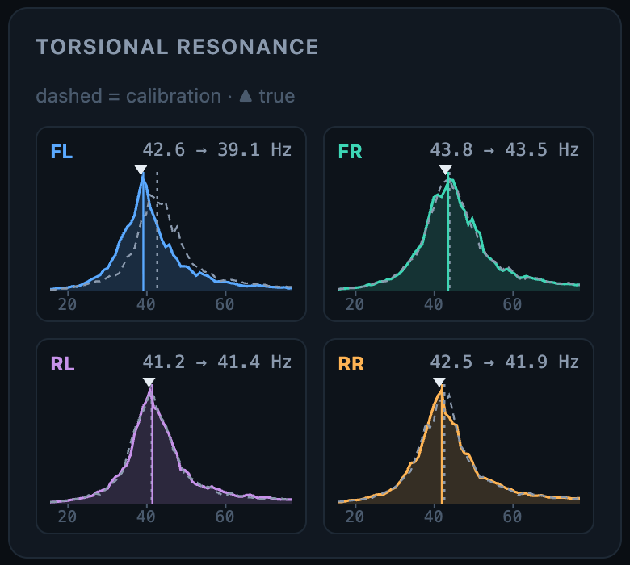
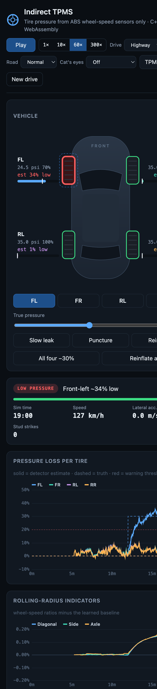
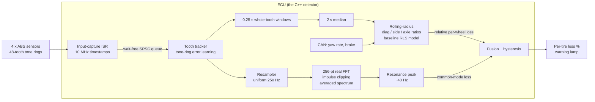

# tpms-cpp: indirect tire-pressure monitoring in C++17

[](https://github.com/rezvee6/tpms-cpp/actions/workflows/ci.yml)


**Detects under-inflated tires using only the four ABS wheel-speed sensors**, with no sensors inside the wheels. The detector is written to the budget of a cheap automotive ECU (Cortex-M4F class: 32 KB RAM, no heap, float only). It ships with a vehicle/tire physics simulator and a live WebAssembly dashboard.



*Front-left tire losing 1.75 psi/min. The rolling-radius indicators climb, the resonance peak slides left, and the warning lamp comes on.*

---

## Highlights

| | |
|---|---|
| **Two detection methods, fused** | Rolling-radius comparison (relative, very precise) + sidewall torsional resonance via FFT (absolute, catches all four tires low) |
| **Accuracy** | ±1.8 pp (1σ) estimate error across 1,404 randomized simulated drives; ≥20% loss warned in 98% of runs, ≥25% in 100% |
| **No false alarms** | 0 in 702 healthy drives, including rough roads and cat's eyes |
| **RAM** | `sizeof(Detector)` = **12.3 KB**, checked against 32 KB with `static_assert` |
| **CPU** | **~11 ns per tooth edge** natively (~0.003% of one core in real time); 256-point FFT 413 ns |
| **Embedded hygiene** | No heap (enforced by a test), no exceptions/RTTI, float only (`-Wdouble-promotion -Werror`), wait-free ISR queue, wrap-safe 32-bit timer math |
| **Zero dependencies** | Standard library only. Tests, benchmark and accuracy sweep are plain executables |

## Screenshots

| Single tire low (30%) | All four tires low (resonance method) |
|---|---|
|  |  |
| **Driving on a line of cat's eyes** | **Calibrating after a TPMS reset** |
|  |  |

<p align="center">
  
  
</p>

*Left: per-wheel rim-speed spectra. Dashed = calibration, solid = now; ▲ marks the simulator's true resonance. The deflated front-left peak has shifted down by 3.5 Hz.*

---

## How it works



1. **Tooth edges in.** Each wheel's ABS tone ring has 48 teeth, so the ECU sees 3,000–7,000 edges per second across four wheels. An ISR timestamps each edge and pushes it into a lock-free queue.
2. **Rolling radius.** An under-inflated tire has a smaller rolling radius, so it turns slightly faster: about 0.3% faster for a 30% loss. Three wheel-speed ratios cancel common effects: **diagonal** (FL+RR vs FR+RL), **side** (left vs right, corrected for cornering using the yaw sensor) and **axle** (front vs rear). A baseline model regressed on speed² and acceleration is learned after the driver presses *TPMS reset*. Deviations from it reveal which tire is low.
3. **Torsional resonance.** The sidewall is a torsional spring between rim and tread, so rim speed carries a resonance near 40 Hz. Lower pressure means a softer spring and a lower frequency. This gives an *absolute* per-wheel estimate, so it can detect all four tires low together, which no ratio can.
4. **Fusion.** Rolling radius supplies precise *relative* differences between wheels. Resonance supplies the *common mode*.

A deeper write-up with diagrams is in [docs/ARCHITECTURE.md](docs/ARCHITECTURE.md). Accuracy, cat's eyes and safety are covered in [docs/ACCURACY.md](docs/ACCURACY.md).

---

## Notable code

### ISR-safe input: one wait-free push per tooth edge

The only code that runs in interrupt context. If the background task ever falls behind, edges are counted as dropped, never silently lost. [`detector.hpp`](core/include/itpms/detector.hpp)

```cpp
// ISR context: record one tooth edge (input-capture timestamp).
bool on_tooth_edge(Wheel w, std::uint32_t timestamp) noexcept {
  if (queue_.push(Edge{timestamp, w})) return true;
  dropped_.fetch_add(1, std::memory_order_relaxed);
  return false;
}
```

```cpp
// spsc_ring.hpp: free-running 32-bit indices; N divides 2^32 so wrap needs no special case.
bool push(const T& v) noexcept {
  const std::uint32_t head = head_.load(std::memory_order_relaxed);
  if (head - tail_.load(std::memory_order_acquire) == N) return false;
  buf_[head & kMask] = v;
  head_.store(head + 1, std::memory_order_release);
  return true;
}
```

### The RAM budget is a compile error, not a guideline

```cpp
static_assert(sizeof(Detector) <= kRamBudgetBytes, "detector exceeds the ECU RAM budget");
static_assert(std::atomic<std::uint32_t>::is_always_lock_free, "ISR-safe ring needs lock-free atomics");
```

### FFT tables computed by the compiler (flash, not RAM)

`constexpr` Taylor-series trig bakes the Hann window, twiddle factors and bit-reversal table into `.rodata`. Nothing is computed at boot. [`ct_math.hpp`](core/include/itpms/ct_math.hpp), [`fft.hpp`](core/include/itpms/fft.hpp)

```cpp
constexpr double sin(double x) {
  x = wrap_pi(x);
  double term = x, sum = x;
  for (int n = 1; n < 13; ++n) {
    term *= -x * x / static_cast<double>((2 * n) * (2 * n + 1));
    sum += term;
  }
  return sum;
}

template <std::size_t N>
class RealFft {
  // ...
  static constexpr std::array<Complex, kHalf> kTwiddle = make_twiddles();
  static constexpr std::array<std::uint16_t, kHalf> kBitrev = make_bitrev();
};
```

The real-input FFT packs 256 real samples into a 128-point complex FFT and splits the result **in place**, so the only scratch is the output buffer.

### Learning the tone ring's machining errors

Each tooth gap is learned relative to the mean gap of the last revolution. Without this, tooth-spacing errors appear as spurious harmonics of wheel rotation, which sweep right through the 20–60 Hz resonance band. [`detector.cpp`](core/src/detector.cpp)

```cpp
tt.rev_sum += period - tt.period[k];  // modular arithmetic keeps the sum exact
tt.period[k] = period;
// ...
const float ratio = static_cast<float>(period) * static_cast<float>(kTeeth) / static_cast<float>(tt.rev_sum);
tt.corr[k] += kToothAlpha * (ratio - tt.corr[k]);
// ...
const float speed = kRadPerTooth * kTimerHzF * tt.corr[k] / static_cast<float>(period);  // rad/s
```

### Rolling-radius indicators, with cornering removed

```cpp
x[kDiagonal] = (rate[FL] + rate[RR]) / (rate[FR] + rate[RL]) - 1.0f;
x[kAxle] = (rate[FL] + rate[FR]) / (rate[RL] + rate[RR]) - 1.0f;
// In a left turn the left wheels follow a shorter arc: remove the kinematic
// left/right speed ratio (1 - kT/2) / (1 + kT/2) using the yaw sensor.
const float h = 0.5f * cfg_.track_width_m * vehicle_.yaw_rate_rps / v;
x[kSide] = (rate[FL] + rate[RL]) / (rate[FR] + rate[RR]) * (1.0f + h) / (1.0f - h) - 1.0f;
```

### Inverting the indicators and fusing both methods

The three indicators are orthogonal ±1 patterns over the wheels, so a closed-form inverse recovers each wheel's speed excess. The resonance method supplies the part the ratios can't see.

```cpp
const std::array<float, kWheels> excess = {0.5f * (d + s + a), 0.5f * (-d - s + a), 0.5f * (-d + s - a),
                                           0.5f * (d - s - a)};
// ...
ws.loss_radius = excess[w] / cfg_.radius_sensitivity;
ws.loss = ws.loss_radius + common;  // common = mean resonance-based loss of all four
if (ws.loss >= cfg_.warn_loss) ws.warning = true;
else if (ws.loss < cfg_.clear_loss) ws.warning = false;
```

### Impulse robustness (cat's eyes, potholes)

A ~2 s running median on the radius samples (`std::nth_element` on a fixed array, no heap). FFT frames are winsorized when a sample exceeds 4.5 × RMS. A frame is clipped rather than dropped, so a road studded for minutes never starves the estimator.

```cpp
float median(const std::array<float, kMedianTaps>& v, std::size_t n) noexcept {
  std::array<float, kMedianTaps> tmp = v;
  const auto mid = tmp.begin() + static_cast<std::ptrdiff_t>(n / 2);
  std::nth_element(tmp.begin(), mid, tmp.begin() + static_cast<std::ptrdiff_t>(n));
  return *mid;
}
```

### Wrap-safe timer comparisons

The 10 MHz capture timer wraps every 429 s. The simulator deliberately starts 20 s before the wrap, so every test exercises it.

```cpp
inline bool reached(std::uint32_t now, std::uint32_t deadline) noexcept {
  return static_cast<std::int32_t>(now - deadline) >= 0;
}
```

---

## Results

### Accuracy (1,404 simulated drives, randomized tires per car)

| True loss | Mean error | Std dev | Warned (threshold 20%) | Median time to warn |
|---|---|---|---|---|
| 10% | +0.7 pp | 1.9 pp | 0/24 | – |
| 15% | −0.4 pp | 1.8 pp | 3/24 | 7.9 min |
| 20% | −0.1 pp | 1.8 pp | 23/24 | 4.2 min |
| 25% | −0.5 pp | 1.8 pp | 24/24 | 2.2 min |
| 30% | +0.0 pp | 1.9 pp | 24/24 | 1.4 min |
| 30%, all four tires | −0.3 pp | 1.1 pp | 6/6 | 0.6 min |

Full tables, cat's eyes results and the noise floor: [docs/ACCURACY.md](docs/ACCURACY.md).

### CPU (`./build/itpms_bench`, Apple Silicon, Release build)

| Drive | Edges/s | ns per edge | Mean 1 ms task | p99 task | CPU load |
|---|---|---|---|---|---|
| Highway | 3,032 | 11.0 | 33 ns | 208 ns | 0.0033% |
| City | 846 | 21.2 | 18 ns | 42 ns | 0.0018% |
| Mixed | 2,532 | 11.8 | 30 ns | 167 ns | 0.0030% |

The worst-case input is 6,845 edges/s at 250 km/h. The 256-entry queue covers 37 ms of task stall. In the browser (WebAssembly) the same detector measures 12–19 ns per edge.

### RAM breakdown

| Edge queue | Tooth tracking | Resampler | Spectra | FFT scratch | Radius model | **Total** |
|---|---|---|---|---|---|---|
| 2,056 B | 1,648 B | 4,192 B | 2,096 B | 2,056 B | 212 B | **12,564 B / 32,768 B** |

---

## Build and run

```bash
cmake -S . -B build && cmake --build build -j
./build/itpms_tests          # 16 unit + scenario tests
./build/itpms_bench          # CPU benchmark
./build/itpms_accuracy 6     # accuracy sweep (multi-threaded, ~1 min)
```

Headless scenarios:

```bash
./build/itpms_cli --minutes 24 --set 12:FL:0.7                    # FL to 70% at minute 12
./build/itpms_cli --scenario city --leak 10:RR:0.7                # slow leak, 0.7 psi/min
./build/itpms_cli --set 8:ALL:0.7                                 # all four low
./build/itpms_cli --cats-eyes straddle --set 12:RL:0.7            # driving on a stud line
```

Web dashboard (a prebuilt `web/itpms.js` is committed, so Emscripten is only needed to rebuild it):

```bash
python3 -m http.server 8765 --directory web   # open http://localhost:8765
./web/build.sh                                # rebuild the WebAssembly module
```

URL parameters script a scene, e.g. `?seed=1&t=19&ev=12:FL:p0.7&pause=1` fast-forwards 19 simulated minutes with the front-left tire set to 70% at minute 12. `docs/capture.sh` regenerates every screenshot in this README this way.

## Repository layout

```
core/     the embedded detector: the only code under the ECU constraints
sim/      vehicle + tire physics simulator, ECU-style harness (1 ms task, 100 Hz CAN)
tests/    zero-dependency test runner (unit, no-heap, scenario tests)
bench/    CPU benchmark
tools/    headless scenario CLI, accuracy sweep
web/      embind bindings and the dashboard (HTML/CSS/JS, no frameworks)
docs/     architecture, accuracy, screenshot script
```

## Not a safety device

This is a demonstration built and validated against a simulator, not real vehicles. A production TPMS needs regulatory approval (UN R141 / FMVSS 138), ISO 26262 functional-safety work, and validation on real tires, loads, temperatures and road surfaces. See [docs/ACCURACY.md](docs/ACCURACY.md#is-it-safe) for what that would take.
