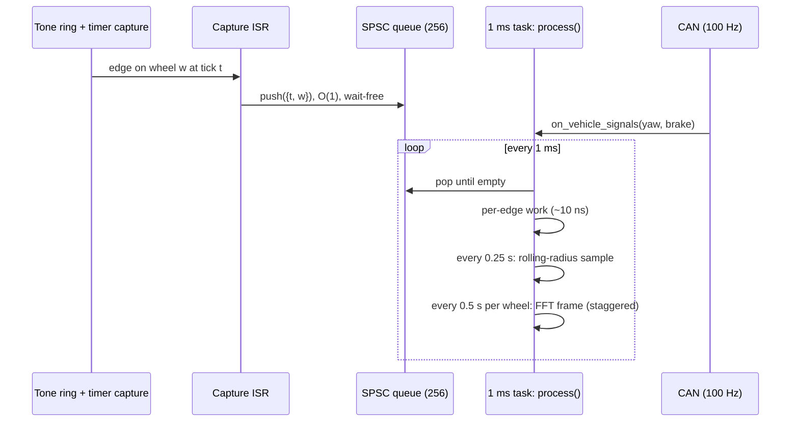
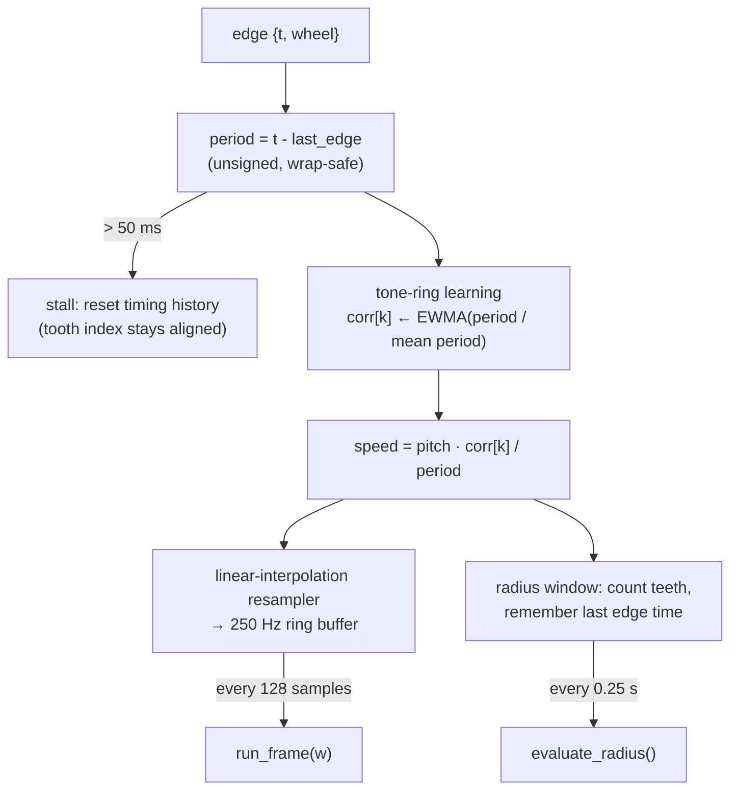
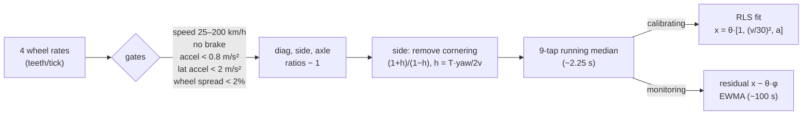
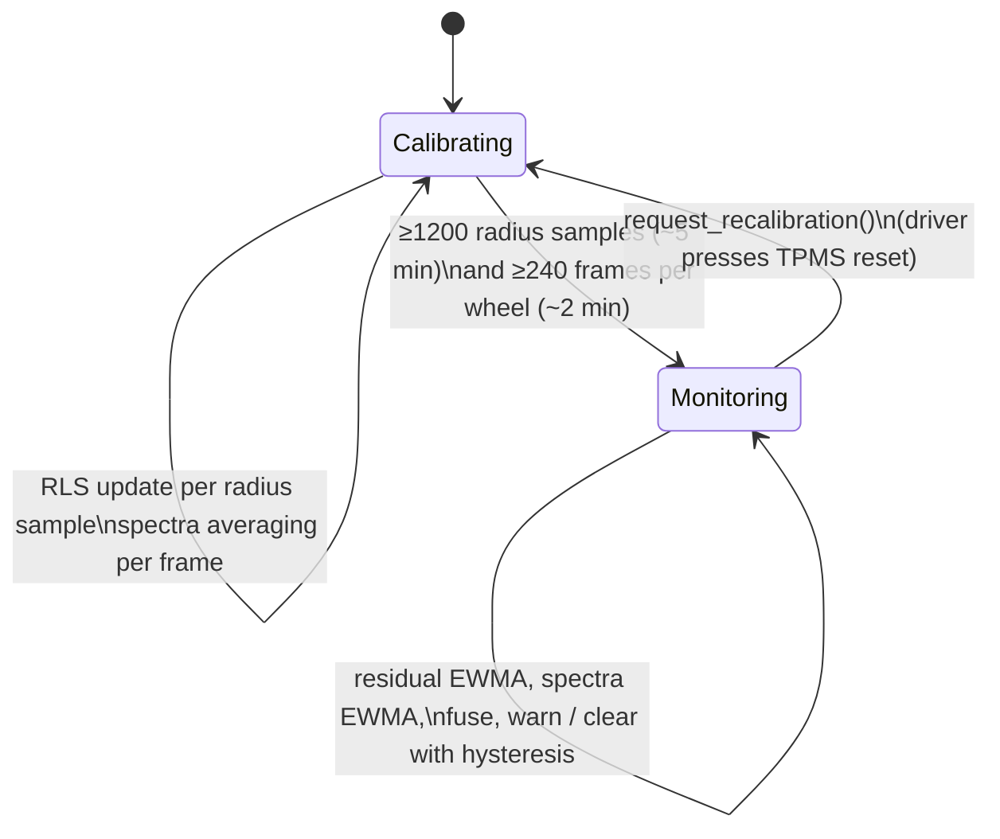

# Architecture

This is the design of the detector (`core/`), the simulator (`sim/`) and how they are wired together. The detector is the only part written under ECU constraints. Everything else exists to drive it, test it, or show it.

## Contents

- [Execution model](#execution-model)
- [Per-edge data path](#per-edge-data-path)
- [Rolling-radius pipeline](#rolling-radius-pipeline)
- [Resonance pipeline](#resonance-pipeline)
- [Calibration and fusion](#calibration-and-fusion)
- [Memory map](#memory-map)
- [Embedded constraints and how they're enforced](#embedded-constraints-and-how-theyre-enforced)
- [Simulator](#simulator)
- [Harness, tests and WebAssembly](#harness-tests-and-webassembly)

---

## Execution model

The detector mirrors how real ABS/ESC software is split between an interrupt and a periodic task:



| API | Context | Cost |
|---|---|---|
| `on_tooth_edge(w, t)` | ISR | one ring-buffer push |
| `on_vehicle_signals(s)` | task | struct copy |
| `process()` | task | ~10 ns per queued edge; plus at most one FFT frame per wheel per 0.5 s |
| `status()` | task | copies a ~200 B struct |

The four wheels' FFT frames are **staggered by a quarter hop**, so the 1 ms task never runs more than one FFT in a call:

```cpp
// Stagger the four wheels by a quarter hop so FFTs never pile up in one call.
const std::size_t phase = (rs.count + w * (kFftHop / kWheels)) % kFftHop;
if (rs.fill == kFftSize && phase == 0) run_frame(w);
```

## Per-edge data path



Two details make this robust:

- **Whole-tooth windows.** A rolling-radius sample is `teeth / (t_last − t_first)` over edges, never a partial tooth. So timer quantisation (0.1 µs) and tooth-spacing errors contribute ~10⁻⁵ relative error.
- **Tone-ring error learning.** Stamped tone rings have tooth-position errors of around 1%. The detector learns a per-tooth correction and renormalises its mean to 1 every revolution, because acceleration biases all teeth equally. Without it, rotation harmonics (14, 28, 42… Hz at 100 km/h) pollute the resonance band.

## Rolling-radius pipeline



**Why these three ratios?** They are orthogonal ±1 patterns over the four wheels. Each cancels a different nuisance:

| Indicator | Pattern (FL FR RL RR) | Cancels | Sensitive to |
|---|---|---|---|
| Diagonal | + − − + | drive slip (same on both driven wheels), cornering (first order) | single-tire loss |
| Side | + − + − | drive slip | one side low; cornering (corrected via yaw rate) |
| Axle | + + − − | cornering | front or rear pair low; drive slip (modelled) |

**Baseline model.** Drive slip on the front-wheel-drive axle is about 0.3% at 100 km/h, the same size as a 30% pressure loss. It depends on aero drag (∝ v²) and acceleration. So each indicator's baseline is a linear model `θ·[1, (v/30)², a]` fitted by recursive least squares while calibrating. All three indicators share one 3×3 covariance matrix, because they have the same regressors. A ridge prior keeps it well conditioned when the calibration drive is at constant speed.

```cpp
// k = P φ / (1 + φᵀ P φ), shared by all three indicators
for (std::size_t i = 0; i < 3; ++i) gain[i] = pphi[i] / denom;
for (std::size_t j = 0; j < kIndicators; ++j) {
  auto& th = model_.theta[j];
  const float e = x[j] - (th[0] * phi[0] + th[1] * phi[1] + th[2] * phi[2]);
  for (std::size_t i = 0; i < 3; ++i) th[i] += gain[i] * e;
}
```

**Inversion to wheels.** Because the patterns are orthogonal, each wheel's speed excess over the four-wheel mean has a closed form: `FL = (d+s+a)/2`, `FR = (−d−s+a)/2`, `RL = (−d+s−a)/2`, `RR = (d−s−a)/2`. A single tire low by *x* shows up as +¾x on that wheel and −¼x on the others. That is why healthy tires dip slightly negative in the radius-only estimate.

## Resonance pipeline

```mermaid
flowchart LR
    R["256 samples @ 250 Hz<br/>(1.02 s, 50% overlap)"] --> D["remove mean + linear trend"]
    D --> CL["winsorise at 4.5·RMS<br/>(two passes)"]
    CL --> H["Hann window<br/>(constexpr table)"]
    H --> F["real FFT 256<br/>(128-pt complex + split)"]
    F --> B["band power 15.6–77 Hz<br/>normalised to unit sum"]
    B --> AV["EWMA spectrum<br/>(~32 s)"]
    AV --> PK["peak bin → quadratic fit<br/>of log-power ±5 bins"]
```



- **Gated** to 40–200 km/h, no braking, |accel| < 2 m/s², tone-ring corrections converged.
- **Normalised band power** means frames at 50 km/h and 150 km/h carry equal weight in the average.
- **Peak estimate.** The resonance is broad (damping ζ≈0.12, so the −3 dB width is ~10 Hz). A parabola fitted to the log-spectrum over ±5 bins gives sub-bin precision. Any fixed bias is cancelled because it is compared with the same estimator's value at calibration.
- **Pressure from frequency.** With `f ∝ p^0.25` the loss is `1 − (f/f_ref)^4`.

The real FFT packs even/odd samples into a 128-point complex FFT, then splits `Z[k]` and `Z[M−k]` *pairwise*, so it can write `X[k]` and `X[M−k]` in place:

```cpp
for (std::size_t k = 1; k <= kHalf / 2; ++k) {
  const Complex a = buf[k];
  const Complex b = buf[kHalf - k];
  buf[k] = split(a, b, kTwiddle[k]);
  if (k != kHalf - k) buf[kHalf - k] = split(b, a, kTwiddle[kHalf - k]);
}
```

It is verified against a naive DFT to a relative error below 1e-5 in `tests/tests.cpp`.

## Calibration and fusion



At the end of calibration, `f_ref` and the reference spectrum are captured and the RLS model is frozen. Fusion is deliberately simple and explainable:

```
loss[w] = radius_excess[w] / radius_sensitivity        // relative to the 4-wheel mean
        + mean over all wheels of (1 − (f/f_ref)^4)     // common mode from resonance
warn  when loss ≥ 20 %;  clear when loss < 12 %
```

Indirect systems share one limitation. **Whatever pressure the tires have during calibration becomes "normal"**, so the driver must reset at the correct pressures. The UI warns about this.

## Memory map

`Detector::memory_report()` returns these numbers at runtime. The dashboard shows them live.

| Block | Bytes | Contents |
|---|---|---|
| Edge queue | 2,056 | 256 × `{uint32 t, uint8 wheel}` + 2 atomics |
| Tooth tracking | 1,648 | per wheel: 48 periods, 48 corrections, window state |
| Resampler | 4,192 | per wheel: 256-float ring + interpolation state |
| Spectra | 2,096 | per wheel: 64-bin current + 64-bin reference spectrum |
| FFT scratch | 2,056 | 256 floats + 129 complex, shared by all wheels |
| Radius model | 212 | RLS covariance, 3×3 θ, EWMAs, 9-tap median rings |
| **Total** | **12,564** | **38% of the 32 KB budget** |

Tables (twiddles, bit reversal, Hann window) are `constexpr` and live in flash, not RAM.

## Embedded constraints and how they're enforced

| Constraint | Enforcement |
|---|---|
| ≤ 32 KB RAM | `static_assert(sizeof(Detector) <= kRamBudgetBytes)` |
| No heap | Test replaces global `operator new` and fails if the detector allocates during a 60 s drive |
| No exceptions / RTTI | Core compiled with `-fno-exceptions -fno-rtti` |
| Float only (M4F has a single-precision FPU) | `-Wdouble-promotion -Werror`; every literal is `f`-suffixed |
| No silent narrowing | `-Wconversion -Wsign-conversion -Wold-style-cast -Werror` |
| ISR safety | `static_assert(std::atomic<uint32_t>::is_always_lock_free)`; single-producer/single-consumer ring |
| Timer wrap | `reached(now, deadline)` via signed difference; the simulator wraps the timer 20 s into every run |
| Bounded latency | Per-edge work O(1); FFT frames staggered across wheels |

## Simulator

`sim/vehicle_sim.cpp` steps at 4 kHz and emits exactly what the ECU would see. Each tire gets hidden "truth" parameters that the detector never sees:

| Effect | Model |
|---|---|
| Driver and road | Highway / country / city / mixed profiles; speed targets, curves, slowing for lateral acceleration, city stops |
| Cornering | Inner wheels on a shorter arc; front axle on a slightly larger one |
| Slip | `F = m·a + ½ρCdA·v² + Crr·m·g`; FWD drive slip, 70/30 brake split; slip stiffness 18 |
| Rolling radius | 0.31 m × (1 + manufacturing spread σ=0.15% − sensitivity × pressure loss); sensitivity varies ±10% per tire |
| Torsional mode | Per-tire 40–45 Hz, ζ 0.10–0.14, `f ∝ p^(0.25±10%)`, excited by road roughness |
| Road noise | Per-wheel slowly varying path-length noise |
| Cat's eyes | One stud every 18 m on one side, front then rear wheel one wheelbase later: a torsional kick plus extra rotation. Lane-change or straddle modes |
| Sensors | 48-tooth rings with σ=0.8% tooth errors, 10 MHz capture quantisation, yaw sensor with bias and noise |

## Harness, tests and WebAssembly

`sim/harness.cpp` couples the two the way an ECU would: edges go into the queue, a 1 ms task calls `process()`, and CAN signals arrive at 100 Hz. Each 0.5 s chunk is simulated first and then replayed into the detector under one stopwatch. That keeps detector timing separate from simulator cost, even in browsers that coarsen `performance.now()`.

The same `Harness` drives:

- `itpms_tests`: unit tests (FFT vs DFT, constexpr trig, ring buffer, no-heap, budget) and scenario tests (no false alarms on three road types, each wheel, all four, slow leak, recalibration)
- `itpms_bench`: per-call latency distribution
- `itpms_accuracy`: the multi-threaded accuracy sweep in [ACCURACY.md](ACCURACY.md)
- `web/wasm_bindings.cpp`: embind wrapper for the dashboard
